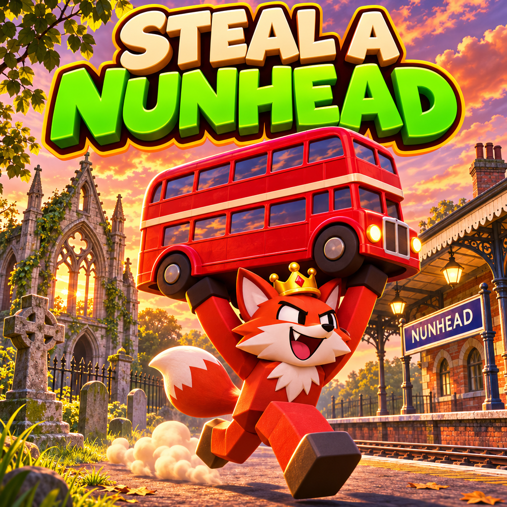

# Steal a Nunhead

A Roblox game in the "Steal a..." genre (the loop behind *Steal a Brainrot* and *Steal An Egg*),
set in a stylised Nunhead, South London.

Buy local characters and landmarks off the conveyor belt on Evelina Road, put them on the pedestals
in your gaff so they earn cash, and nick the good stuff from everyone else's. Lock your base when
you need a breather. Everyone gets a cricket bat.



## How it plays

| Thing | Where | What it does |
|---|---|---|
| Conveyor belt | North pavement of Evelina Road | Spawns a collectible every couple of seconds. Press **E** to buy. |
| Your gaff | One of 8 plots either side of the road | 10 pedestals. Walk into an empty one while carrying to place. |
| Collect pad | Just inside your door | Step on it to bank what your pedestals have stored. |
| Someone else's pedestal | Their gaff | **Hold E** to steal. Run it home before they clobber you. |
| Lock panel / LOCK BASE button | Inside your door / HUD | Shield your doorway for 45 s, 90 s recharge. |
| Cricket bat | Your backpack | Click near a thief: they drop what they're carrying and stumble. |

33 collectibles across 6 rarities, from the *Nunhead Station Pigeon* (£25, £1/s) to *MEGA FOX*
(£200K, £7.5K/s). See `src/shared/Collectibles.luau`. Rarer tiers spawn more often the more players
are on the server. Epic and above are announced to everyone.

## Project layout

```
default.project.json     Rojo project (maps src/ onto the Roblox DataModel)
src/shared/              ReplicatedStorage.Shared - config, catalogue, formatting, remotes, asset ids
src/server/              ServerScriptService.Server - map, plots, conveyor, economy, carrying/stealing, locks, bat, saving
src/client/              StarterPlayerScripts.Client - HUD, toasts, sounds, own-plot tweaks
assets/                  Generated audio / images / meshes + manifest.json
scripts/                 Asset upload, Assets.luau regeneration, place publishing (Open Cloud)
tests/                   Lune test runner + specs for the Roblox-free modules
.github/workflows/       CI: tests, build, optional publish
```

Everything in the world (map, plots, collectibles, cricket bat, UI) is built from code at runtime,
so the whole game lives in this repo and nothing has to be hand-placed in Studio.

## Developing

Install [Rokit](https://github.com/rojo-rbx/rokit) then:

```bash
rokit install            # Rojo 7.4 + Lune 0.11 (pinned in rokit.toml)
lune run tests/run       # syntax-compiles every .luau file and runs tests/specs
rojo build -o build/StealANunhead.rbxl
```

Open the `.rbxl` in Roblox Studio and press Play, or use `rojo serve` with the
[Rojo Studio plugin](https://create.roblox.com/store/asset/13916111004) for live sync.

In Studio, enable **Game Settings > Security > Enable Studio Access to API Services** if you want
DataStore saving to work in test sessions.

## Assets

Generated with Higgsfield (sound effects, icon, thumbnail) and FlashBoards/Suno (music). Files live
under `assets/` and are mapped to Luau keys in `assets/manifest.json`. Until they are uploaded to
Roblox the ids in `src/shared/Assets.luau` are `0` and the game simply plays no sound / uses the
part-built item models.

See [docs/DEPLOY.md](docs/DEPLOY.md) for uploading assets and publishing the place.

## Tuning

All the numbers are in `src/shared/Config.luau`: prices and incomes in `Collectibles.luau`, rarity
weights in `Rarity.luau`.
