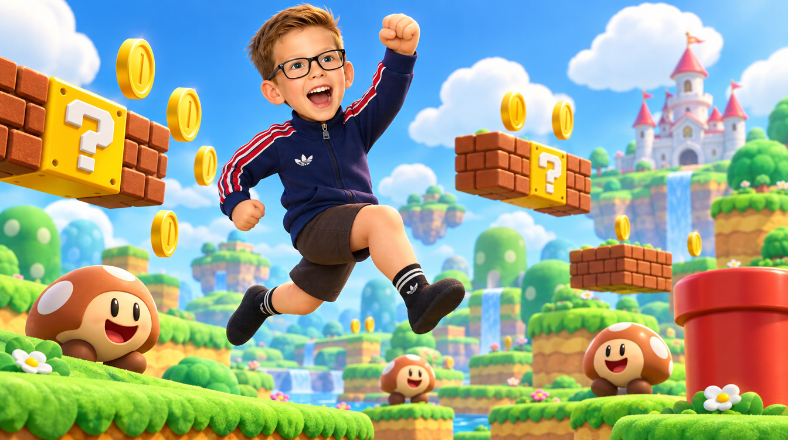

# Cam's Shut Up World

A Mario-style 3D open-world platformer starring Cam as the main character.
Every time he moves, jumps, stomps, grabs a coin or bonks a block, he says
**"shut up"** in his own voice.



## Play it

No build step. Serve the folder with any static server and open `index.html`:

```bash
python3 -m http.server 8000
# then open http://localhost:8000
```

Or push to GitHub Pages: the root `index.html` loads Three.js from a CDN and
every asset from `public/`.

| Control | Action |
| --- | --- |
| `W A S D` / arrow keys | move (relative to the camera) |
| `Shift` | run |
| `Space` | jump (hold for a higher jump) |
| drag mouse / `Q` `E` | orbit the camera, mouse wheel zooms |
| `M` | music on/off |
| touch | on-screen joystick + JUMP button on phones |

Collect coins (25 coins = 1-UP), bonk `?` blocks from below, stomp the
mushroom goombas from above, find the flag by the castle for a course clear.
Touching a goomba from the side costs a life.

### What's in the world

- **Realistic look** — photoreal seamless textures (grass, dirt, brick, castle stone, bark, water, lava, steel) generated with Higgsfield, a gradient sky with a sun, sky-based reflections on coins and metal, wind-swayed grass blades, flowers, rocks, textured trees, soft 4K shadows on desktop. Cam himself is a 62k-triangle PBR model with normal and roughness maps.
- **Football mode** — walk onto the pitch (west of spawn, under the floodlights) to kick off a 60-second match. Run into the ball to kick it, jump into it to lob it, beat the two goalkeepers. Goals count in both nets.
- **Power-ups** (respawn after 40 s): jetpack (hold jump in the air to fly), speed boots, super spring, star power (invincible, enemies die on touch), giant Cam (twice the size, crushes everything).
- **Mods** (gear button): infinite jetpack, moon gravity, giant Cam, speed demon, rainbow mode, graphics quality, music.
- **Missions** (flag button): coins, stomps, block bonks, football goals, jetpack flight time, the Sky Tower spiral, the castle flag, power-ups. Progress is saved on the device.
- **Enemies and hazards** — goombas (stomp), spiky shells (never stomp), swooping bats, piranha plants in pipes, cannons that fire bullets, rotating fire bars, lava pools, spike plates on the gauntlet, thwomp crushers, moving platforms.

### On a phone

The game is built for touch first: a big left thumb-stick (push far to run),
a JUMP button on the right, and dragging anywhere else on the screen turns
the camera. Pressing PLAY goes fullscreen and asks for landscape; portrait
works too with a wider camera. Add it to the Home Screen (iOS Safari share
menu or Android "Install") for a chromeless, app-like launch. Phones get a
lighter renderer: capped pixel ratio, smaller shadow map, fewer trees and
shorter draw distance. Safe-area insets keep the HUD clear of the notch.

### What Cam says

| Event | Line |
| --- | --- |
| start moving, every 1.4 s while moving, every jump, every kick | **"Shut up!"** (his real takes from the video) |
| coin | "Yay!" |
| stomp an enemy, bonk a `?` block, score a goal | "Oh yeah!" |
| bonk a brick, get hurt | "Ooh!" |
| fall in the pond, game over | "Oh no!" |
| 1-UP, course clear | "Woo hoo!" |

The "shut up" lines are the four real takes from the video. The other lines
were generated with Higgsfield's `seed_audio` model using the video audio as
the voice reference, then trimmed and normalised. Every line is also shown
in a speech bubble over his head.

## How Cam was made (Higgsfield pipeline)

1. **Reference** – frames were pulled from `IMG_9007.mov` (Cam shouting "shut
   up" four times) and uploaded as identity references.
2. **Avatar concept** – `gpt_image_2_5` with the three frames as references
   produced a Nintendo-style 3D character render in A-pose on white
   (`public/art/cam_apose_a.png`, `cam_apose_b.png`), keeping his face, hair,
   glasses, navy track jacket with red/white sleeve stripes, brown shorts and
   black socks.
3. **3D model** – Meshy `image_to_3d` (textured, remeshed to ~20k triangles,
   humanoid auto-rig at 1.4 m, Idle clip), then `3d_rigging` on the result for
   the `RunFast` and `Regular_Jump` clips. The three single-clip GLBs were
   merged by bone name into `public/models/cam.glb` (clips: `Idle`, `Run`,
   `Jump`).
4. **Voice** – the four on-camera "shut up" takes were cut from the video
   audio and peak-normalised: `public/audio/shutup_1..4.mp3`. The game cycles
   through them with a little pitch variation. Extra reactions ("Yay!",
   "Ooh!", "Oh yeah!", "Oh no!", "Woo hoo!") were cloned from the same clip
   with `seed_audio` (audio reference = the video's audio track).
5. **World style** – key art and an environment style sheet
   (`public/art/world_style.png`) set the look; the in-game world is built
   procedurally from that palette.
6. **Music + SFX** – `sonilo_music` overworld loop, `mirelo_text_to_audio`
   coin and stomp sounds.

### Style formula (used for every generated visual)

> Nintendo-style stylized 3D render, smooth rounded appealing proportions with
> slightly oversized head and hands, clean matte surfaces with soft
> subsurface skin; environment in candy greens, sky blue and brick orange,
> hero in navy with red/white stripes so he pops against the grass, pickups
> and hazards in gold and mushroom brown; cheerful midday sunlight with soft
> shadows; high contrast, clean readable silhouettes, free third-person
> camera.

## Project layout

```
index.html            page, HUD, panels, touch controls
src/core.js           config, audio, renderer, textures/materials, player state
src/world.js          sky, terrain, grass, decor, platforms, coins, pipes, castle, flag
src/entities.js       enemies, hazards, power-ups, moving platforms
src/football.js       pitch, ball physics, keepers, match
src/game.js           player, input, camera, mods + missions panels, main loop
public/models/cam.glb rigged + animated HD Cam (Idle / Run / Jump)
public/textures/      seamless textures (jpg)
public/audio/         shutup_1..4.mp3, reactions, music_overworld.mp3, coin.mp3, stomp.mp3
public/art/           avatar renders, key art, world style sheet, screenshots
```

Debug URL parameters: `?q=low|high` quality, `?at=x,z` spawn point, `?power=jetpack` start with a power-up, `?b64=1` force the text-encoded model.

### Tuning knobs (`src/game.js`, top of file)

`CFG.runShoutEvery` – seconds between "shut up"s while he keeps moving.
`CFG.jumpSpeed`, `CFG.gravity`, `CFG.walkSpeed`, `CFG.runSpeed` – feel.
`CFG.modelYawOffset` – rotate the GLB if a re-export faces the wrong way.
`CFG.pitch` – where the football pitch sits (the terrain flattens there).
`POWER` in `src/entities.js` – power-up durations.
